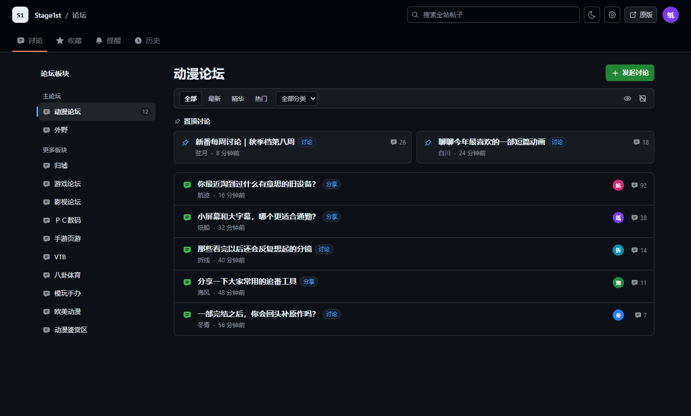

# Stage1st GitHub 风格

一个 Stage1st 用户脚本。板块、主题列表和帖子详情采用 GitHub Discussions 风格，支持浅色、深色和跟随系统。

## 安装

1. 在浏览器中安装 Tampermonkey 或 Violentmonkey。
2. 如果已启用「Stage1st 企业微信主题」，先在脚本管理器里停用它。
3. 点击 [安装 Stage1st GitHub 风格](https://raw.githubusercontent.com/Aezir/stage1st-github-theme/main/stage1st-github.user.js)，确认安装，再打开 [Stage1st](https://stage1st.com/2b/forum.php)。

用右上角的主题按钮切换配色。点击「原版」或按 `Alt + W` 可切回论坛原版页面。

## 预览

讨论列表包含板块侧栏、置顶讨论和分类筛选。帖子详情包含回复时间线、参与者侧栏和 BBCode 预览。手机上可在列表与帖子详情之间切换。

## 来源和许可

基于 XX NB 的 [Stage1st 企业微信主题 v0.2.3](https://greasyfork.org/zh-CN/scripts/607161)，沿用 Stage1st 的网页接口。审核和屏蔽状态按论坛网页返回结果显示。项目采用 [MIT 许可证](LICENSE)。
